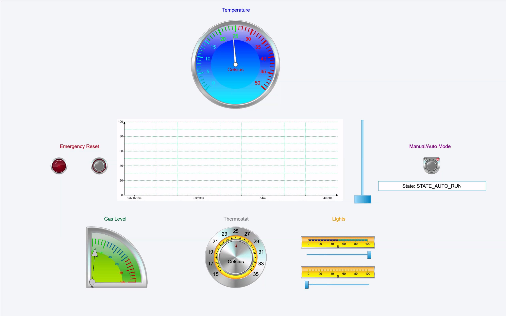
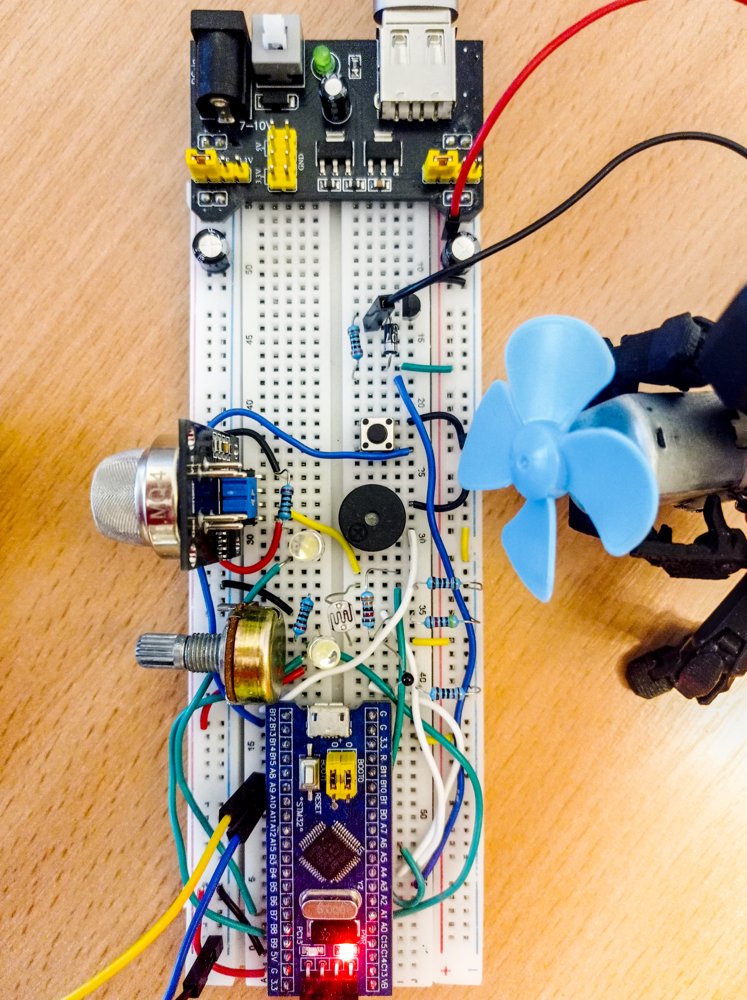
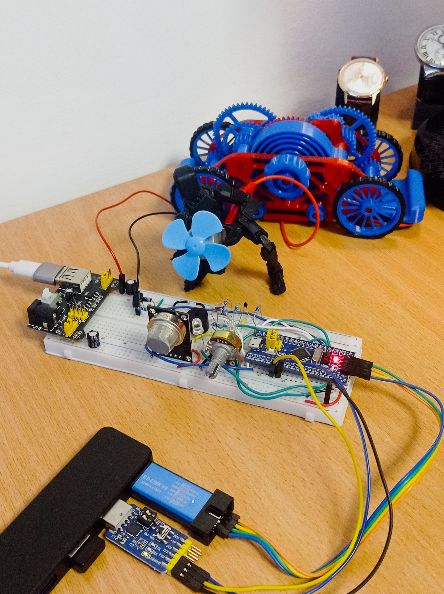
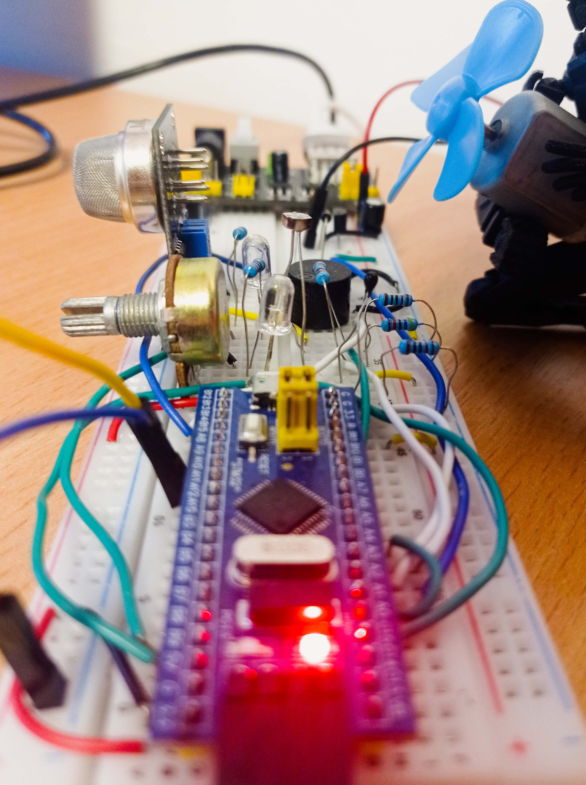

# Industrial Environmental & Safety Control System (CODESYS V3.5 + STM32)

An industrial automation, closed-loop climate regulation, and smart daylight-harvesting system built in **CODESYS V3.5 (IEC 61131-3 Structured Text)** interfaced with an **STM32 microcontroller** hardware I/O layer. The project combines deterministic state-machine safety interlocks, anti-stall PI thermal control, bumpless manual overrides, and a responsive **TargetVisu** HMI with adaptive ambient light theming.

---

## HMI Dashboard Preview


*CODESYS HMI showing real-time second-resolution trend graphs, system state supervision, manual override sliders, and adaptive Dark/Light ambient theming.*

---

## Hardware & Breadboard Prototype

| Full Breadboard Setup | Sensor Acquisition Stage | Actuator & Safety Stage |
| :---: | :---: | :---: |
|  |  |  |
| *STM32 controller, power rails, and field wiring* | *NTC thermistor, MQ gas sensor, LDR, and setpoint potentiometer* | *PWM cooling fan, dual LED zones, buzzer, and active-low E-Stop* |

---

## Key Engineering Features

### 1. Deterministic Safety & State Supervisor (`E_SystemState`)
* **Centralized State Machine:** Manages transitions cleanly across `STATE_INIT`, `STATE_STANDBY`, `STATE_AUTO_RUN`, `STATE_MANUAL_OVERRIDE`, `STATE_GAS_ALARM`, and `STATE_ESTOP_TRIP`.
* **Fail-Safe Active-Low Emergency Stop:** Monitors a normally closed E-Stop switch (`PB13`). Pressing the button or breaking the wire (`0`) immediately cuts motor power, triggers a continuous acoustic alarm, and latches `bSafetyLatched` until cleared by an explicit HMI operator reset (`bHMI_Reset`).
* **Gas Leak Interlock:** Validates analog MQ gas sensor readings against ADC out-of-bounds thresholds and applies a `2.0%` hysteresis deadband. Exceeding the limit escalates to `STATE_GAS_ALARM`, shuts off the fan, and drives a `1 Hz` pulsed alarm buzzer (`TON` timer).

### 2. Closed-Loop PI Thermal Regulation (`FB_PI_Regulator`)
* **NTC Thermistor Conditioning (`FB_NTC_Sensor`):** Converts 12-bit ADC readings into degrees Celsius with open/short-circuit fault detection (`bSensorFault`).
* **Hysteresis + Discrete PI Loop:** Activates cooling above `Setpoint + 1.0 °C` and modulates PWM duty cycle smoothly (`Kp = 8.0`, `Ki = 0.15`, `50 ms` cyclic task).
* **Anti-Stall Dead-Band Compensation:** Enforces a `35.0%` minimum starting duty cycle (`rMotorMinDuty`) in automatic mode to overcome static rotor friction and prevent low-PWM motor stalling.

### 3. Staged Daylight Harvesting & Bumpless Transfer (`FB_RampLimiter`)
* **5-Stage Ambient Lighting Control:** Reads ambient brightness from the LDR and stages dual LED lighting zones (`0%`, `50%`, `100%`) across four thresholds (`35%`, `50%`, `65%`, `80%`).
* **Slew-Rate Limited Dimming:** Uses `FB_RampLimiter` (`2.5%` per `50 ms` scan) for smooth, flicker-free transitions.
* **Bumpless Auto $\leftrightarrow$ Manual Transfer:** Captures active actuator duty cycles on mode transitions (`bManualMode AND NOT bWasManual`) so switching to manual HMI sliders produces zero output jumps.

### 4. Adaptive HMI (TargetVisu & WebVisu)
* **Ambient-Triggered Dark/Light Mode:** Automatically transitions the HMI background between Light (`#FFF5F7FA`) and Dark Charcoal (`#FF1E2229`) with a `5%` LDR hysteresis deadband and smooth per-scan RGB channel ramping.
* **Desktop & Mobile Ready:** Configured at `1920 × 1080` with **Isotropic** scaling for local `TargetVisu` operation and remote mobile browser control over Wi-Fi via `WebVisu` (`http://<PLC_IP>:8080/webvisu.htm`).

---

## Hardware I/O Mapping (STM32)

| Signal Variable | Direction | STM32 Pin / Peripheral | Signal Type | Description |
| :--- | :--- | :--- | :--- | :--- |
| `wPotentiometer_Raw` | `VAR_INPUT` | `PA0` (ADC) | 12-bit (`0–4095`) | Temperature setpoint (`15.0 °C – 35.0 °C`) |
| `wThermistor_Raw` | `VAR_INPUT` | `PA3` (ADC) | 12-bit (`0–4095`) | NTC ambient temperature sensor |
| `wGas_Raw` | `VAR_INPUT` | `PA4` (ADC) | 12-bit (`0–4095`) | MQ gas concentration sensor |
| `wLDR_Raw` | `VAR_INPUT` | `PA5` (ADC) | 12-bit (`0–4095`) | Photoresistor (LDR) ambient light sensor |
| `wEStop_Raw` | `VAR_INPUT` | `PB13` (GPIO) | Digital Active-Low | Emergency Stop (`0` = Pressed, `1` = Released) |
| `wMotorPWM` | `VAR_OUTPUT` | `PA2` (`TIM2` PWM) | `0–100%` Duty | Cooling fan speed control |
| `wLed1PWM` | `VAR_OUTPUT` | `PB8` (`TIM4` PWM) | `0–100%` Duty | Lighting Zone 1 brightness |
| `wLed2PWM` | `VAR_OUTPUT` | `PB9` (`TIM4` PWM) | `0–100%` Duty | Lighting Zone 2 brightness |
| `wBuzzer` | `VAR_OUTPUT` | `PB12` (GPIO) | Digital (`0 / 1`) | Acoustic alarm (`1 Hz` gas / continuous E-Stop) |

---

## Project Structure

```text
stm32-codesys-modbus/
├── firmware/                               # Bare-metal STM32 C firmware & build system
│   ├── linker.ld                           # Linker script defining Flash/RAM memory layout
│   ├── main.c                              # Main control loop, ADC, TIM2/TIM4 PWM & Modbus slave
│   ├── Makefile                            # ARM GCC build and flashing rules
│   ├── registers.h                         # Direct peripheral register definitions & bitmasks
│   └── startup.c                           # Vector table & Reset_Handler initialization
├── media/                                  # HMI screenshots & hardware prototype photos
│   ├── codesys_hmi.png
│   ├── breadboard1jpg
│   ├── breadboard2.jpg
│   └── breadboard3.jpg
├── plc/                                    # CODESYS V3.5 Modbus Master & HMI visualization
│   ├── ModbusMaster_STM32.project          # Main CODESYS V3.5 project
│   └── ModbusMaster_STM32.projectarchive   # Self-contained CODESYS archive
└── README.md
